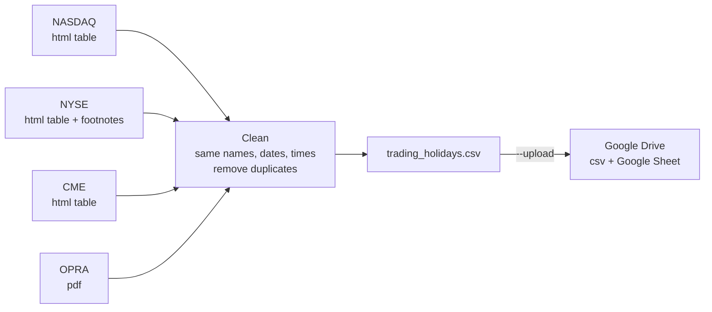

# Trading holidays scraper

Gets the trading holidays from NASDAQ, NYSE, CME and OPRA, saves them to
`trading_holidays.csv` and uploads it to Google Drive (as a csv and as a Google Sheet).

Sources:
- NASDAQ: https://www.nasdaqtrader.com/Trader.aspx?id=Calendar
- NYSE: https://www.nyse.com/markets/hours-calendars
- CME: https://www.cmegroup.com/tools-information/holiday-calendar.html
- OPRA: https://www.opraplan.com/ (pdf with the holiday schedule)


## How it works




## Install

```
python3 -m venv .venv
source .venv/bin/activate
pip install -r requirements.txt
```


## Run

```
python scraper.py            # only creates trading_holidays.csv
python scraper.py --upload   # also uploads it to google drive
```


## Connect to Google Drive (only once)

1. Go to https://console.cloud.google.com and create a new project.
2. Search for "Google Drive API" and click Enable.
3. Go to "OAuth consent screen" and fill in an app name and your email. Choose "External".
4. In "Audience" -> "Test users", add your gmail.
5. Go to "Credentials" -> "Create credentials" -> "OAuth client ID" -> type "Desktop app".
6. Download the json file, rename it to `credentials.json` and put it in this folder.
7. Run `python scraper.py --upload`. It prints a link, open it, log in and allow access.
   (Google will say the app is not verified, click Continue.)

After that a `token.json` file is saved and you don't need to log in again.
To use another account, delete `token.json` and run it again.

The files go to "My Drive". To use a specific folder, put the folder id in `FOLDER_ID`
at the top of `scraper.py` (it's the last part of the folder url).

Don't share or commit `credentials.json` and `token.json`.
